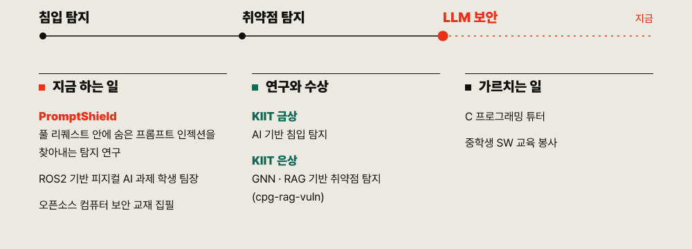
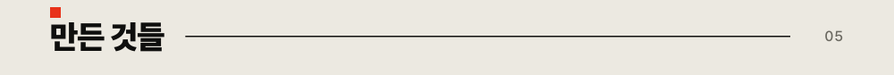

<picture>
  <source media="(prefers-color-scheme: dark)" srcset="assets/hero-dark.svg">
  
</picture>

<picture>
  <source media="(prefers-color-scheme: dark)" srcset="https://img.shields.io/badge/PromptShield-f0442a?style=for-the-badge">
  
</picture>
<picture>
  <source media="(prefers-color-scheme: dark)" srcset="https://img.shields.io/badge/LLM%20%EB%B3%B4%EC%95%88-2b2a27?style=for-the-badge">
  
</picture>
<picture>
  <source media="(prefers-color-scheme: dark)" srcset="https://img.shields.io/badge/GNN-2b2a27?style=for-the-badge">
  
</picture>
<picture>
  <source media="(prefers-color-scheme: dark)" srcset="https://img.shields.io/badge/RAG-2b2a27?style=for-the-badge">
  
</picture>
<picture>
  <source media="(prefers-color-scheme: dark)" srcset="https://img.shields.io/badge/ROS2-2b2a27?style=for-the-badge">
  
</picture>
<picture>
  <source media="(prefers-color-scheme: dark)" srcset="https://img.shields.io/badge/C-2b2a27?style=for-the-badge">
  
</picture>
<picture>
  <source media="(prefers-color-scheme: dark)" srcset="https://img.shields.io/badge/MLOps-2b2a27?style=for-the-badge">
  
</picture>
<picture>
  <source media="(prefers-color-scheme: dark)" srcset="https://img.shields.io/badge/macOS-2b2a27?style=for-the-badge">
  
</picture>
<picture>
  <source media="(prefers-color-scheme: dark)" srcset="https://img.shields.io/badge/KIIT%20%EA%B8%88%EC%83%81-0d6b57?style=for-the-badge">
  
</picture>

<picture>
  <source media="(prefers-color-scheme: dark)" srcset="assets/about-dark.svg">
  
</picture>

<picture>
  <source media="(prefers-color-scheme: dark)" srcset="assets/h-projects-dark.svg">
  
</picture>

<a href="https://github.com/plmjuio1234/cpg-rag-vuln">
<picture>
  <source media="(prefers-color-scheme: dark)" srcset="assets/card-cpg-rag-vuln-dark.svg">
  
</picture>
</a>

<a href="https://github.com/plmjuio1234/burst-gpt-rate-limiting">
<picture>
  <source media="(prefers-color-scheme: dark)" srcset="assets/card-burst-gpt-rate-limiting-dark.svg">
  
</picture>
</a>

<a href="https://github.com/plmjuio1234/human-ai-text-classifier">
<picture>
  <source media="(prefers-color-scheme: dark)" srcset="assets/card-human-ai-text-classifier-dark.svg">
  
</picture>
</a>

<a href="https://github.com/plmjuio1234/publicdoc-ai-search">
<picture>
  <source media="(prefers-color-scheme: dark)" srcset="assets/card-publicdoc-ai-search-dark.svg">
  
</picture>
</a>

<a href="https://github.com/plmjuio1234/llm-meter">
<picture>
  <source media="(prefers-color-scheme: dark)" srcset="assets/card-llm-meter-dark.svg">
  
</picture>
</a>

<picture>
  <source media="(prefers-color-scheme: dark)" srcset="assets/h-stats-dark.svg">
  
</picture>

<picture>
  <source media="(prefers-color-scheme: dark)" srcset="https://github-readme-stats.vercel.app/api?username=plmjuio1234&show_icons=true&hide_border=true&bg_color=0f0f0e&title_color=ece9e1&text_color=ece9e1&icon_color=f0442a&ring_color=46c2a1">
  
</picture>
<picture>
  <source media="(prefers-color-scheme: dark)" srcset="https://github-readme-stats.vercel.app/api/top-langs/?username=plmjuio1234&layout=compact&hide_border=true&bg_color=0f0f0e&title_color=ece9e1&text_color=ece9e1&icon_color=f0442a&ring_color=46c2a1">
  
</picture>

<picture>
  <source media="(prefers-color-scheme: dark)" srcset="https://streak-stats.demolab.com?user=plmjuio1234&hide_border=true&background=0f0f0e&ring=f0442a&fire=f0442a&currStreakNum=ece9e1&sideNums=ece9e1&currStreakLabel=46c2a1&sideLabels=ece9e1&dates=ece9e1">
  
</picture>

<picture>
  <source media="(prefers-color-scheme: dark)" srcset="assets/h-contact-dark.svg">
  
</picture>

<a href="mailto:eunsung020717@gmail.com">eunsung020717@gmail.com</a> · <a href="https://orcid.org/0009-0008-2783-9662">ORCID</a>

<picture>
  <source media="(prefers-color-scheme: dark)" srcset="assets/band-dark.svg">
  
</picture>

